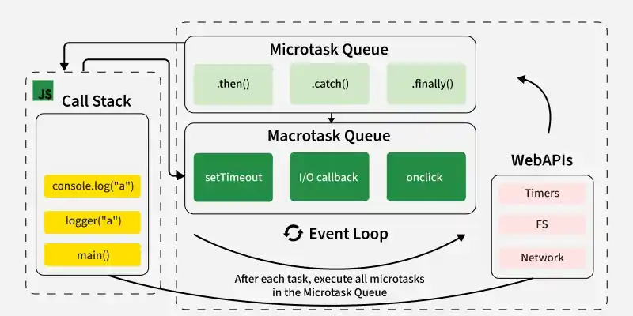

Non-blocking I/O and the **event loop** (popularized by Node.js, Netty, NGINX, and modern reactive frameworks) replace the resource-heavy "thread-per-request" model with a single-threaded (or small, fixed-pool) dispatcher that handles massive concurrency without blocking operating system threads.

---

[Geeksforgeeks - What is event loop](https://www.geeksforgeeks.org/javascript/what-is-an-event-loop-in-javascript/)

[Dev.to - How does event Loop Work](https://dev.to/betelgeuseas/how-does-event-loop-work-2mdg)

### How the Event Loop Works

Instead of dedicating a dedicated OS thread to wait for a database query or an external network call, the application uses an **event loop** running on a tiny pool of CPU-bound worker threads (typically matching the number of CPU cores).

1. **Accepting the Request:**
   When an incoming HTTP request arrives, an asynchronous event listener captures it and pushes a callback task onto an internal execution queue.
2. **Non-Blocking Execution:**
   A single-threaded loop picks up the task and starts executing the code. The moment the code hits an I/O operation (like fetching data from a database or calling a payment API), **it does not block the thread.**
3. **Registering with the OS Kernel:**
   Instead, the application hands the operation over to the underlying OS kernel (using mechanisms like `epoll` on Linux or `kqueue` on macOS) and immediately frees up the thread to handle the next incoming request.
4. **The Callback / Completion:**
   While the thread is happily serving other users, the OS monitors the network socket or disk operation. Once the database responds, the OS places a completion event back into the event loop's queue.
5. **Resuming Work:**
   The event loop picks up the completion event along with the original data callback and finishes processing the request, sending the response back to the client.

---

### Blocking vs. Non-Blocking Flow

OS threads required: Blocking (1:1 model) vs Non-blocking (Event loop 4-8 threads)
