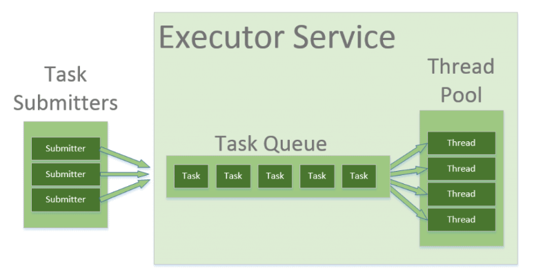

A **thread pool** is a managed collection of pre-instantiated, reusable worker threads. Instead of spawning a fresh thread for every incoming task—which incurs significant memory and CPU overhead from thread creation and destruction—a thread pool accepts tasks, assigns them to an available thread from the pool, and queues or discards them if all threads are busy.

This design pattern helps control resource consumption, prevents thread exhaustion, and improves response latency by amortizing thread lifecycle costs.



---

### Core Types of Thread Pools in Java

Java provides these thread pool implementations primarily through the `Executors` factory class (backed by the `ThreadPoolExecutor` and `ScheduledThreadPoolExecutor` classes):

#### 1. Fixed Thread Pool (`Executors.newFixedThreadPool(int nThreads)`)

- **How it works:** Allocates a fixed number of threads. If all threads are active and more tasks arrive, they are held in an unbounded queue (specifically, a `LinkedBlockingQueue`) until a thread frees up.
- **When to use:** Use this when you need to limit the maximum number of concurrent threads to protect a finite resource (like a database connection pool or CPU cores) and you expect a stable, predictable load.

#### 2. Cached Thread Pool (`Executors.newCachedThreadPool()`)

- **How it works:** Creates threads as needed, but reuses previously constructed threads whenever they are available. Threads that remain idle for 60 seconds are terminated and removed from the cache. It uses a `SynchronousQueue`, which hands off tasks directly to threads without storing them.
- **When to use:** Ideal for applications with many short-lived asynchronous tasks. _Caution:_ Because the pool size is unbounded, a sudden spike in traffic can cause the JVM to spawn thousands of threads, leading to thread exhaustion or an `OutOfMemoryError`.

#### 3. Single Thread Executor (`Executors.newSingleThreadExecutor()`)

- **How it works:** Uses a single worker thread to operate an unbounded queue. If the thread dies due to an unexpected exception, a new one is spawned to take its place.
- **When to use:** Use this when tasks must be executed sequentially in strict order (FIFO) without concurrent interference, such as writing to a single log file or processing state transitions in a queue consumer.

#### 4. Scheduled Thread Pool (`Executors.newScheduledThreadPool(int corePoolSize)`)

- **How it works:** Designed for running tasks after a given delay or periodically. It uses a specialized `DelayedWorkQueue`.
- **When to use:** Ideal for periodic maintenance jobs, polling loops, heartbeats, or delayed execution tasks (e.g., timing out an inactive session).

#### 5. Work-Stealing Pool (`Executors.newWorkStealingPool()`)

- **How it works:** Introduced in Java 7, this pool utilizes a `ForkJoinPool` and assigns each thread its own queue. If a thread exhausts its queue, it "steals" work from the tail of another thread's queue.
- **When to use:** Best for fine-grained, highly parallel CPU-bound tasks that can be recursively split into smaller sub-tasks (e.g., parallel data processing, matrix multiplication).

---

### Production Best Practice: Avoid Default Factories

While the `Executors` factory methods are convenient, production systems often avoid `newFixedThreadPool` and `newCachedThreadPool` because their internal queues are unbounded. If the task arrival rate exceeds the processing rate, the queue or thread count grows unchecked, crashing the application with an `OutOfMemoryError`.

For robust production software, instantiate `ThreadPoolExecutor` directly with explicit bounds:

```java
ThreadPoolExecutor executor = new ThreadPoolExecutor(
    4,                               // corePoolSize
    10,                              // maximumPoolSize
    60L, TimeUnit.SECONDS,           // keepAliveTime
    new ArrayBlockingQueue<>(100),   // bounded work queue
    new ThreadPoolExecutor.CallerRunsPolicy() // rejection policy
);

```
